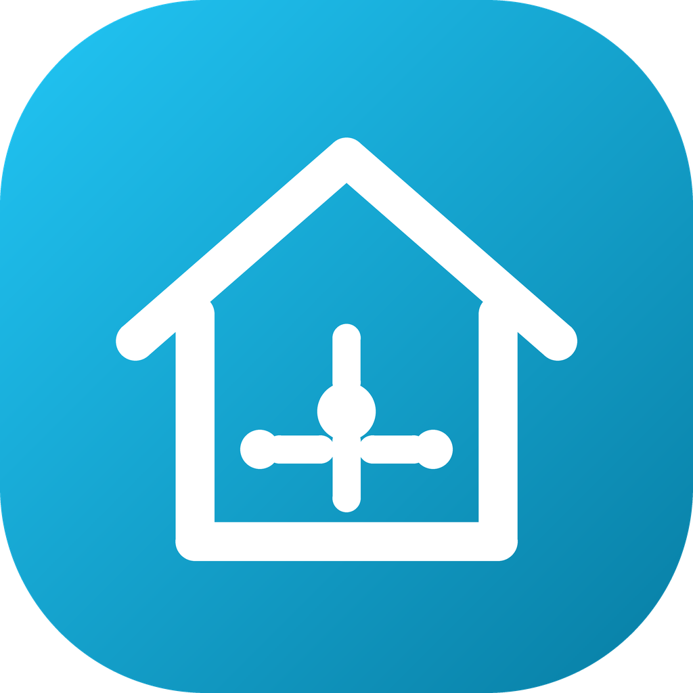
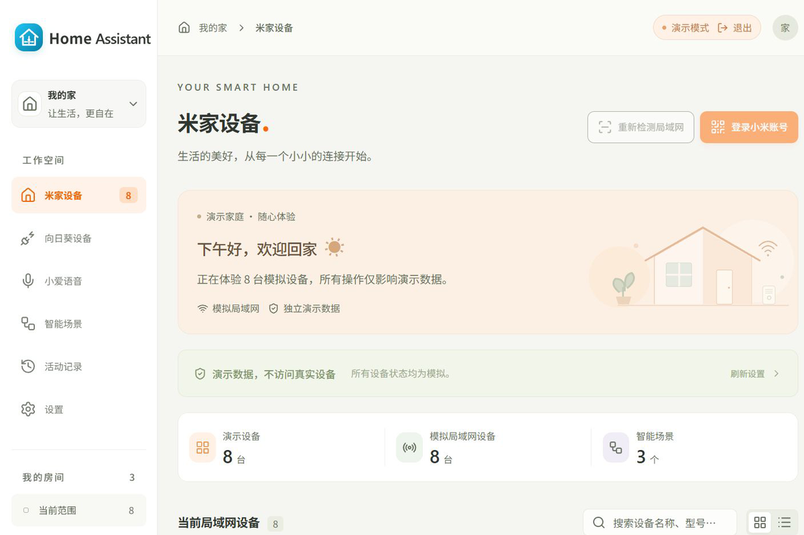

# Home Assistant Control

### 把智能家居，留在自己的局域网。

**一个本地优先的控制中心，统一管理兼容的米家设备与向日葵插座，支持 Windows、macOS 和浏览器客户端。**

[English](README.md) | 简体中文 | [更新日志](CHANGELOG.md)

**[下载](#下载安装) · [功能](#功能) · [激活与购买](#激活与购买) · [兼容性](#兼容性) · [常见问题](#常见问题) · [支持](#支持)**

> **关于本仓库**
>
> 这是 Home Assistant Control 的官方发布与文档仓库。源代码维护在私有仓库。请从 [Releases](https://github.com/yuan-xin-9997/HomeAssistantControl/releases/latest) 下载安装包，或在[商店](https://hacontrol.yuan-xin.top/)购买授权。

## 项目简介

Home Assistant Control 在一台常开的家用电脑上运行小型控制中心。它登录小米账号导入兼容的米家设备，通过局域网发送真实 miIO/MIoT 指令，也可以扫描和控制向日葵插座。其他电脑使用配对码连接控制中心，在 Windows、macOS 或浏览器里共享同一套设备与场景。

- 不需要端口映射、云端中转或订阅。
- 设备凭据使用 AES-GCM 加密落盘。
- 激活码绑定机器，日常使用不会连接授权服务器。
- 安装包免费，控制真实设备需要购买授权。

## 界面预览

## 功能

| 功能 | 说明 |
| --- | --- |
| 米家账号导入 | 扫码或账号密码登录，选择与米家 App 相同的地区，导入兼容 IP 设备的名称、房间和凭据。 |
| 局域网 miIO / MIoT | 读取属性、发送真实局域网指令；控件由型号规格生成，不硬编码属性编号。 |
| 向日葵插座 | 扫描 6767/5767 端口的 C1/C2/P1 系列，支持逐孔开关和功率读取；C2-BLE-V3 等仅云端型号通过向日葵账号控制。 |
| 智能场景 | 把米家属性和向日葵插孔编排成多步场景，在活动记录中查看每一步结果。 |
| 多端控制中心 | 一台电脑运行中心，其他 Windows/macOS/浏览器使用配对码连接；账号和设备状态由中心统一管理。 |
| 本地优先隐私 | 没有遥测、没有云端中转；断网时局域网控制仍然可用。 |
| 演示模式 | 用示例数据体验界面，不需要授权，也不会控制真实设备。 |

## 下载安装

| 下载 | 说明 |
| --- | --- |
| **[HomeAssistantControl-Setup.exe](https://github.com/yuan-xin-9997/HomeAssistantControl/releases/latest/download/HomeAssistantControl-Setup.exe)** | 推荐：Windows 10/11 安装包。 |
| [全部版本](https://github.com/yuan-xin-9997/HomeAssistantControl/releases) | 版本历史、更新说明和旧安装包。 |
| [SHA256SUMS.txt](https://github.com/yuan-xin-9997/HomeAssistantControl/releases/latest/download/SHA256SUMS.txt) | 最新安装包的 SHA-256 校验值。 |
| **[购买授权](https://hacontrol.yuan-xin.top/)** | 购买绑定机器的激活码。 |

**系统要求：** Windows 10/11（64 位）或 macOS 13+。网页面板由同一个程序提供。控制中心与设备必须在同一 IPv4 子网。miIO 使用 UDP 54321；向日葵本地插座使用 TCP 6767/5767。

> 当前 GitHub Release 提供 Windows 安装包。macOS 安装包需要在 macOS 上构建并完成开发者签名/公证后再公开分发；需要 macOS 版本请联系支持。

1. 下载并运行安装包。
2. 启动程序，激活界面会显示本机机器码。
3. 在商店购买授权，并在确认页输入机器码。
4. 把返回的 `HAC-...` 激活码粘贴回程序，点击“激活”。
5. 选择“作为控制中心”，选择家庭网卡并启动。
6. 登录小米账号并导入设备。

## 激活与购买

Home Assistant Control 使用**离线激活**：

- 首次启动时，激活界面显示类似 `ABCD-EFGH-IJKL-MNOP` 的机器码。
- 在[商店](https://hacontrol.yuan-xin.top/)购买授权并提交机器码。
- 商店返回绑定该机器的 `HAC-...` 激活码。
- 把激活码粘贴回程序。程序使用内置 P-256 公钥在本地验签，不连接授权服务器。
- 每份订单可激活 **2 台电脑**；重复提交同一机器码返回同一激活码，不重复占名额。
- 价格：**$9.99 USD**，一次买断，含 1 年更新。

> 已经签发的离线激活码无法远程失效。退款或争议会阻止该订单后续补发和换机。详见[退款政策](https://hacontrol.yuan-xin.top/refund)。

## 兼容性

| 范围 | 支持情况 |
| --- | --- |
| 开放局域网 miIO/MIoT 的米家 Wi-Fi/以太网设备 | 型号和固件允许本地指令时支持 |
| 仅云端米家设备 | 可导入记录，但本程序不做云端远程控制 |
| 蓝牙 / BLE Mesh / Zigbee / Matter | 未实现 |
| 摄像头、门锁、扫地机地图 | 未实现 |
| 向日葵 C1/C2/P1 系列（本地 HTTP） | 支持开关、分孔和用电读取 |
| 向日葵 C2-BLE-V3 等仅云端型号 | 通过向日葵账号和 Oray 云端控制 |
| 跨子网 / 其他家庭 | 不支持；控制中心只控制所选 IPv4 子网 |

设备具备 MIoT 规格不代表固件允许本地控制；请按型号、固件和属性验证。详见[兼容性说明](https://hacontrol.yuan-xin.top/compatibility)。

## 常见问题

### 这是小米或 Home Assistant 官方产品吗？

不是。本产品由独立开发者开发，与小米、米家、向日葵/Oray 及 Home Assistant 项目均无隶属关系。

### 需要联网吗？

局域网控制不需要。登录小米账号、导入设备、同步型号规格和控制仅云端向日葵插座需要联网。拿到激活码后，激活过程完全离线。

### 可以激活几台电脑？

每个订单最多为 2 台不同电脑签发激活码。在每台电脑上打开程序，用该机器的机器码分别领取。

### 有免费版吗？

安装包免费，并提供演示模式；控制真实设备需要一次性授权。

### 1 年更新期结束后还能用吗？

可以继续使用已安装的版本；新版本更新可能需要有效授权。

### 我的数据存在哪里？

设备凭据、场景和设置保存在程序自己的本地数据目录；凭据使用 AES-GCM 加密。程序没有遥测。商店只接收你提交的机器码及其哈希。

### 如何卸载？

Windows 在“设置 → 应用”中卸载；macOS 把应用拖到废纸篓。本地数据目录会保留，以便重装后继续使用；如需彻底清理可手动删除。

## 隐私

程序不会把小米/向日葵密码、会话、设备 Token、设备名称、场景、活动记录或网络扫描上传到商店。商店只从 Creem 获取订单数据，并保存你提交的机器码。详见[隐私政策](https://hacontrol.yuan-xin.top/privacy)。

## 支持

- 商店与激活码：<https://hacontrol.yuan-xin.top/>
- 支持邮箱：<support@yuan-xin.top>
- 问题反馈：在本仓库提交 Issue
- 源代码：私有仓库；本仓库只用于发布和文档

## 更新日志

见 [CHANGELOG.md](CHANGELOG.md)。

---

Home Assistant Control 是专有软件。当前条款和隐私政策以商店页面为准。
