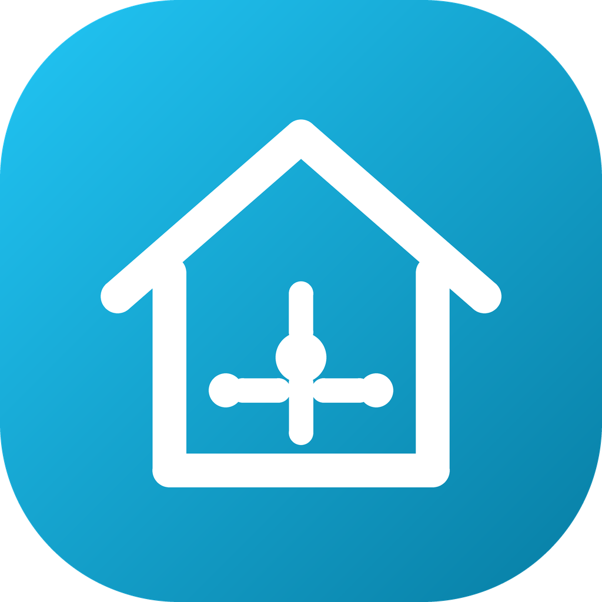
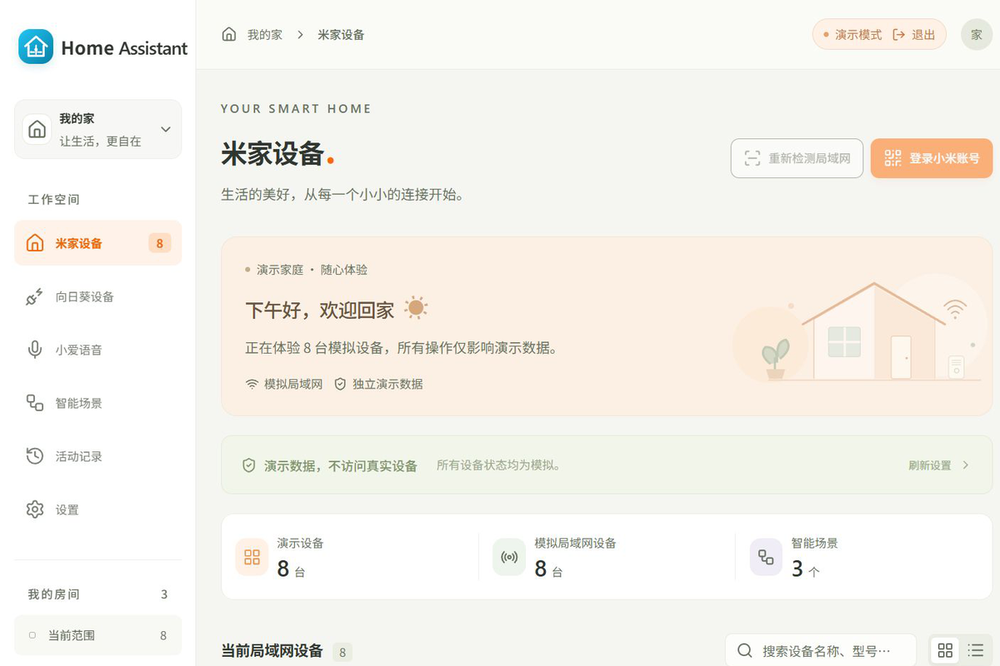

# Home Assistant Control

### Your smart home. On your own LAN.

**A local-first control center for compatible Mijia devices and SunLogin smart plugs, with Windows, macOS and browser clients.**

English | [简体中文](README.cn.md) | [Changelog](CHANGELOG.md)

**[Download](#download--installation) · [Features](#features) · [Activation](#activation--purchase) · [Compatibility](#compatibility) · [FAQ](#faq) · [Support](#support)**

> **About this repository**
>
> This is the official release and documentation repository for Home Assistant Control. The source code is maintained in a private repository. Download the installer from [Releases](https://github.com/yuan-xin-9997/HomeAssistantControl/releases/latest) or buy a license from the [store](https://hacontrol.yuan-xin.top/).

## Overview

Home Assistant Control runs a small control center on an always-on computer in your home. It signs in to your Xiaomi account to import compatible Mijia devices, talks to them over the local network with real miIO/MIoT commands, and can also scan and control SunLogin smart plugs. Other computers connect to the center with a pairing code, so you can use the same devices and scenes from Windows, macOS or a browser.

- No port forwarding, no cloud relay and no subscription.
- Device credentials are encrypted at rest with AES-GCM.
- Activation is a machine-bound offline code. Normal use does not contact a licensing server.
- The installer is free. Real-device control requires a paid license.

## Screenshots

<em>The Windows/macOS app currently uses a Simplified Chinese interface; the layout is the same on every client.</em>

## Features

| Feature | What you get |
| --- | --- |
| Mijia account import | Sign in by QR code or password, choose the same region as the Mijia app, and import compatible IP devices with names, rooms and credentials. |
| Local miIO / MIoT control | Read properties and send real local commands. Controls are generated from each model's specification, not hard-coded property numbers. |
| SunLogin plugs | Discover C1/C2/P1 series plugs on ports 6767/5767, switch individual outlets and read power. C2-BLE-V3 and other cloud-only models use a SunLogin account. |
| Scenes | Run multi-step scenes across Mijia properties and SunLogin outlets, with per-step results in Activity. |
| Multi-client center | Run the center on one computer; connect other Windows/macOS/browser clients with a pairing code. The center owns the account and device state. |
| Local-first privacy | No telemetry and no cloud relay. Local control keeps working when the internet is down. |
| Demo mode | Explore the interface with sample data, without a license and without touching real devices. |

## Download & Installation

| Download | Description |
| --- | --- |
| **[HomeAssistantControl-Setup.exe](https://github.com/yuan-xin-9997/HomeAssistantControl/releases/latest/download/HomeAssistantControl-Setup.exe)** | Recommended: Windows 10/11 installer. |
| [All releases](https://github.com/yuan-xin-9997/HomeAssistantControl/releases) | Version history, release notes and earlier installers. |
| [SHA256SUMS.txt](https://github.com/yuan-xin-9997/HomeAssistantControl/releases/latest/download/SHA256SUMS.txt) | SHA-256 checksum for the latest installer. |
| **[Buy a license](https://hacontrol.yuan-xin.top/)** | Purchase a machine-bound activation code. |

**Requirements:** Windows 10/11 (64-bit) or macOS 13+. The web dashboard is served by the same app. The center and devices must be on the same IPv4 subnet. UDP 54321 is used for miIO; TCP 6767/5767 for local SunLogin plugs.

1. Download and run the installer.
2. Start the app. The activation screen shows your machine code.
3. Buy a license and paste the machine code on the store confirmation page.
4. Paste the returned `HAC-...` code into the app and click **Activate**.
5. Choose **Run as control center**, select the home network interface, and start it.
6. Sign in to your Xiaomi account and import devices.

## Activation & Purchase

Home Assistant Control uses **offline activation**:

- On first launch, the activation screen shows a machine code such as `ABCD-EFGH-IJKL-MNOP`.
- Buy a license from the [store](https://hacontrol.yuan-xin.top/) and submit the machine code.
- The store returns an `HAC-...` activation code bound to that machine.
- Paste it into the app. Verification uses an embedded P-256 public key; no license server is contacted.
- Each order covers **2 computers**. Reusing the same machine code returns the same code without consuming another slot.
- Price: **$9.99 USD**, one-time, including 1 year of updates.

> Already-issued offline codes cannot be revoked remotely. Refunds and disputes stop future reissues and machine changes. See the [refund policy](https://hacontrol.yuan-xin.top/refund).

## Compatibility

| Area | Status |
| --- | --- |
| Mijia Wi-Fi/Ethernet devices with local miIO/MIoT | Supported when the model and firmware expose local commands |
| Mijia cloud-only devices | Imported for records; not controlled remotely by this app |
| Bluetooth / BLE Mesh / Zigbee / Matter | Not implemented |
| Cameras, locks, robot maps | Not implemented |
| SunLogin C1/C2/P1 series with local HTTP | Supported (switch, per-outlet, metering) |
| SunLogin C2-BLE-V3 and other cloud-only models | Supported through a SunLogin account and Oray cloud |
| Cross-subnet / other homes | Not supported; the center only controls its selected IPv4 subnet |

A MIoT specification does not guarantee that the firmware allows local control. Verify by model, firmware and property. See the [compatibility guide](https://hacontrol.yuan-xin.top/compatibility) for details.

## FAQ

### Is this an official Xiaomi or Home Assistant product?

No. It is an independent product, not affiliated with Xiaomi, Mijia, SunLogin/Oray or the Home Assistant project.

### Does it need the internet?

Local control does not. Signing in to Xiaomi, importing devices, syncing model specifications and controlling cloud-only SunLogin plugs need internet access. Activation is fully offline once you have the code.

### How many computers can I activate?

Each order can issue codes for 2 different machines. Open the app on each computer and claim a separate code with that machine's code.

### Is there a free version?

The installer is free and a demo mode is included, but controlling real devices requires a one-time license.

### What happens after the 1-year update period?

The app keeps working at the last version you own. New updates may require a current license.

### Where is my data stored?

Device credentials, scenes and settings stay in the app's local data directory. Credentials are encrypted with AES-GCM. The app has no telemetry. The store only receives the machine code you submit and a hash of it.

### How do I uninstall it?

Use Windows Settings → Apps or drag the macOS app to the Trash. The local data directory is kept so a reinstall can reuse your devices. Remove it manually if you want a clean uninstall.

## Privacy

The app does not upload your Xiaomi/SunLogin password, session, device tokens, device names, scenes, activity or network scans to the store. The store collects order data from Creem and the machine code you submit. See the [privacy policy](https://hacontrol.yuan-xin.top/privacy).

## Support

- Store and activation codes: <https://hacontrol.yuan-xin.top/>
- Support email: <support@yuan-xin.top>
- Report a problem: open an issue in this repository
- Source code: private repository; this repository is for releases and documentation

## Changelog

See [CHANGELOG.md](CHANGELOG.md) for release notes.

---

Home Assistant Control is proprietary software. See the store for the current terms and privacy policy.
