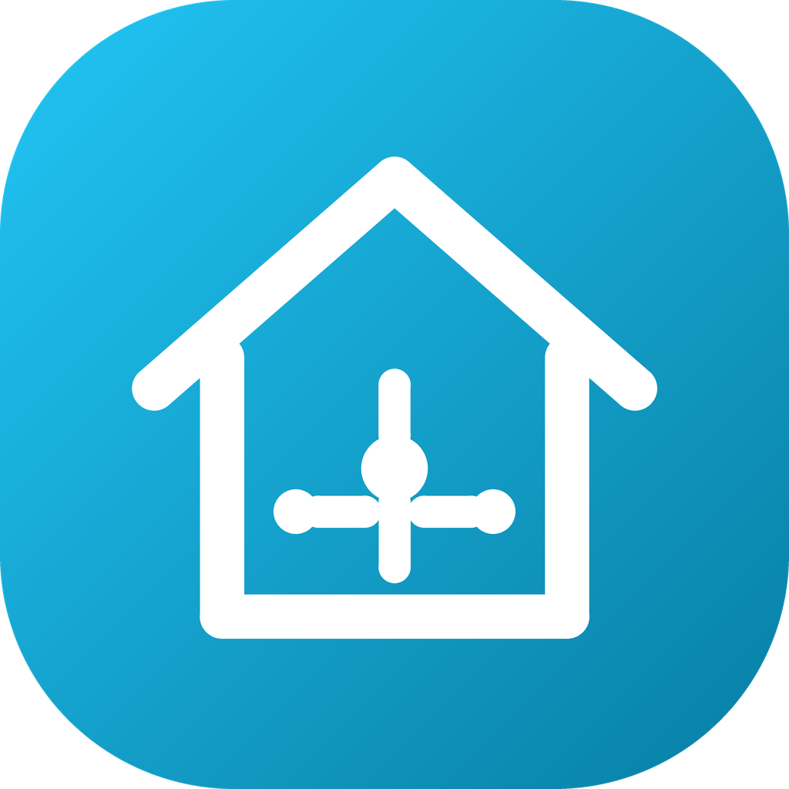
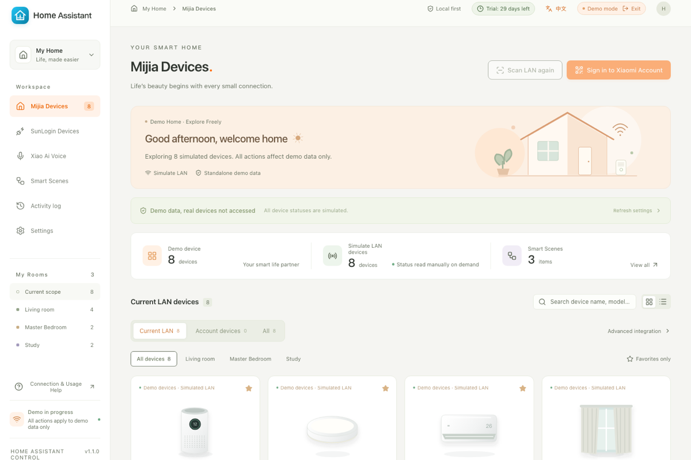

# Home Assistant Control

### Your smart home. On your own LAN.

**A local-first control center for compatible Mijia devices and SunLogin smart plugs, with Windows, macOS and browser clients.**

English | [简体中文](README.cn.md) | [Changelog](CHANGELOG.md)

**[Download](#download--installation) · [Features](#features) · [Free trial](#free-trial) · [Activation](#activation--purchase) · [Compatibility](#compatibility) · [FAQ](#faq) · [Support](#support)**

> **About this repository**
>
> This is the official release and documentation repository for Home Assistant Control. The source code is maintained in a private repository. Download the installer from [Releases](https://github.com/yuan-xin-9997/HomeAssistantControl/releases/latest); every download includes a **30-day free trial**. No email, account or credit card is needed to start it.

## Overview

Home Assistant Control runs a small control center on an always-on computer in your home. It signs in to your Xiaomi account to import compatible Mijia devices, talks to them over the local network with real miIO/MIoT commands, and can also scan and control SunLogin smart plugs. Other computers connect to the center with a pairing code, so you can use the same devices and scenes from Windows, macOS or a browser.

- **30-day free trial with every feature.** Only days on which you actually open the app count; days you skip are not consumed.
- Trial state is kept on the store's server and bound to your machine code, so changing the system clock, reinstalling or clearing app data does not reset it. The remaining days are shown in the launcher and the license panel.
- No port forwarding, no cloud relay and no subscription.
- Device credentials are encrypted at rest with AES-GCM.
- After the trial, activation is a machine-bound offline code. Normal use does not contact a licensing server.

## Screenshots

<em>The app supports English and Simplified Chinese; this screenshot uses demo data.</em>

## Features

| Feature | What you get |
| --- | --- |
| Mijia account import | Sign in by QR code or password, choose the same region as the Mijia app, and import compatible IP devices with names, rooms and credentials. |
| Local miIO / MIoT control | Read properties and send real local commands. Controls are generated from each model's specification, not hard-coded property numbers. |
| SunLogin plugs | Discover C1/C2/P1 series plugs on ports 6767/5767, switch individual outlets and read power. C2-BLE-V3 and other cloud-only models use a SunLogin account. |
| Scenes | Run multi-step scenes across Mijia properties and SunLogin outlets, with per-step results in Activity. |
| Multi-client center | Run the center on one computer; connect other Windows/macOS/browser clients with a pairing code. The center owns the account and device state. |
| Local-first privacy | No telemetry and no cloud relay. Local control keeps working when the internet is down. |
| Demo mode | Explore the interface with sample data, without a license and without touching real devices. |

## What's new in 1.1.0

- **30-day free trial** with every feature, counted only by the days you actually open the app.
- Remaining trial days are visible in the launcher, the top bar and the License panel.
- Trial state is server-backed and machine-bound: reinstalling, clearing app data or changing the system clock does not reset it.
- Offline trial use is supported; queued open days sync when the store is reachable again.
- Optional uninstall feedback on Windows (skippable and non-blocking).
- Recovery by checkout email + machine code, without the order number.

## Download & Installation

| Download | Description |
| --- | --- |
| **[HomeAssistantControl-Setup.exe](https://github.com/yuan-xin-9997/HomeAssistantControl/releases/latest/download/HomeAssistantControl-Setup.exe)** | Recommended: Windows 10/11 installer. |
| [All releases](https://github.com/yuan-xin-9997/HomeAssistantControl/releases) | Version history, release notes and earlier installers. |
| [SHA256SUMS.txt](https://github.com/yuan-xin-9997/HomeAssistantControl/releases/latest/download/SHA256SUMS.txt) | SHA-256 checksum for the latest installer. |
| **[Start the free trial](https://hacontrol.yuan-xin.top/download)** | Download the full app and use every feature for 30 days. |

**Requirements:** Windows 10/11 (64-bit) or macOS 13+. The web dashboard is served by the same app. The center and devices must be on the same IPv4 subnet. UDP 54321 is used for miIO; TCP 6767/5767 for local SunLogin plugs.

> The current GitHub release contains the Windows installer. The macOS build is produced on macOS and requires developer signing/notarization before public distribution; contact support if you need the macOS build.

1. Download and run the installer.
2. Start the app. The 30-day trial starts automatically; the launcher shows the remaining days and your machine code.
3. Choose **Run as control center**, select the home network interface, and start it.
4. Sign in to your Xiaomi account and import devices.
5. If you want to keep controlling real devices after the trial, buy a license, paste the machine code on the store confirmation page and activate the returned `HAC-...` code.

## Free trial

- Every installer includes the full app. The first launch starts a **30-day free trial**; no email, account or credit card is required.
- A day is consumed only when you open the app. If you do not open it, nothing is consumed.
- The count is stored on the store's server and bound to the machine code shown in the app. Changing the system clock, reinstalling, or clearing local app data does not reset it.
- The launcher and the **License & purchase** panel always show the remaining days.
- The first trial check needs internet access. After that the app works offline; offline open days are queued and reported the next time the store is reachable.
- After 30 open days you can keep using demo mode, or buy a license to keep controlling real devices.

## Activation & Purchase

After the free trial, Home Assistant Control uses **offline activation**:

- The app shows a machine code such as `ABCD-EFGH-IJKL-MNOP`.
- Buy a license from the [store](https://hacontrol.yuan-xin.top/purchase) and submit the machine code.
- The store returns an `HAC-...` activation code bound to that machine.
- Paste it into the app. Verification uses an embedded P-256 public key; no license server is contacted.
- Each order covers **2 computers**. Reusing the same machine code returns the same code without consuming another slot.
- One-time purchase, including 1 year of updates. The current price is shown on the store's purchase page and at checkout.
- Lost the code or the receipt? Use [Find my license](https://hacontrol.yuan-xin.top/retrieve) with your checkout email and the machine code; no order number or email delivery is required for a machine that already has a code.

> Already-issued offline codes cannot be revoked remotely. Refunds and disputes stop future reissues and machine changes. See the [refund policy](https://hacontrol.yuan-xin.top/refund).

## Compatibility

| Area | Status |
| --- | --- |
| Mijia Wi-Fi/Ethernet devices with local miIO/MIoT | Supported when the model and firmware expose local commands |
| Mijia cloud-only devices | Imported for records; not controlled remotely by this app |
| Bluetooth / BLE Mesh / Zigbee / Matter | Not implemented |
| Cameras, locks, robot maps | Not implemented |
| SunLogin C1/C2/P1 series with local HTTP | Supported (switch, per-outlet, metering) |
| SunLogin C2-BLE-V3 and other cloud-only models | Supported through a SunLogin account and Oray cloud |
| Cross-subnet / other homes | Not supported; the center only controls its selected IPv4 subnet |

A MIoT specification does not guarantee that the firmware allows local control. Verify by model, firmware and property. See the [compatibility guide](https://hacontrol.yuan-xin.top/compatibility) for details.

## FAQ

### Is this an official Xiaomi or Home Assistant product?

No. It is an independent product, not affiliated with Xiaomi, Mijia, SunLogin/Oray or the Home Assistant project.

### Does it need the internet?

Local control does not. Signing in to Xiaomi, importing devices, syncing model specifications and controlling cloud-only SunLogin plugs need internet access. Activation is fully offline once you have the code.

### How many computers can I activate?

Each order can issue codes for 2 different machines. Open the app on each computer and claim a separate code with that machine's code.

### Is there a free trial?

Yes. Every download includes all features for 30 days. Only days on which you open the app count, and the remaining days are shown in the app. The trial is bound to the machine code and stored on our server, so reinstalling does not reset it. After the trial, real-device control needs a one-time license; demo mode stays free.

### What happens after the 1-year update period?

The app keeps working at the last version you own. New updates may require a current license.

### Where is my data stored?

Device credentials, scenes and settings stay in the app's local data directory. Credentials are encrypted with AES-GCM. The app has no telemetry. During the trial the store receives the machine code, the local dates on which you opened the app, the app version and platform. The store also receives the machine code you submit when claiming a license.

### How do I uninstall it?

Use Windows Settings → Apps, or drag the macOS app to the Trash. On Windows the uninstaller opens an optional 10-second feedback page in your browser; it can be closed immediately and never blocks the uninstall. The local data directory is kept so a reinstall can reuse your devices. Remove it manually if you want a clean uninstall.

## Privacy

The app does not upload your Xiaomi/SunLogin password, session, device tokens, device names, scenes, activity or network scans to the store. The store collects order data from Creem and the machine code you submit. See the [privacy policy](https://hacontrol.yuan-xin.top/privacy).

## Support

- Store and activation codes: <https://hacontrol.yuan-xin.top/>
- Support email: <support@yuan-xin.top>
- Report a problem: open an issue in this repository
- Source code: private repository; this repository is for releases and documentation

## Changelog

See [CHANGELOG.md](CHANGELOG.md) for release notes.

---

Home Assistant Control is proprietary software. See the store for the current terms and privacy policy.
